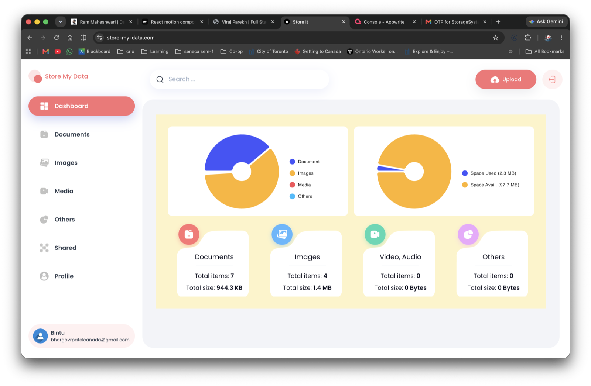
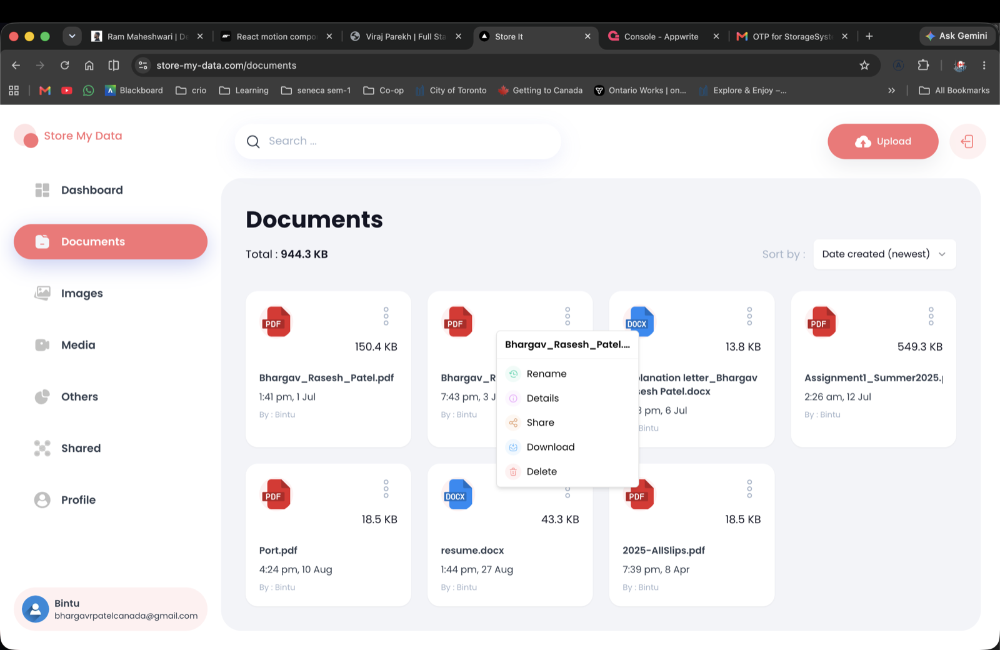
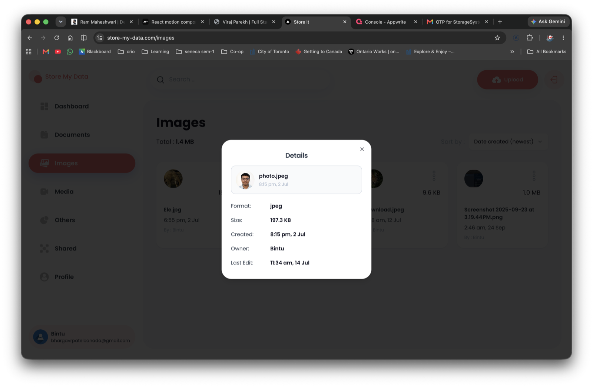
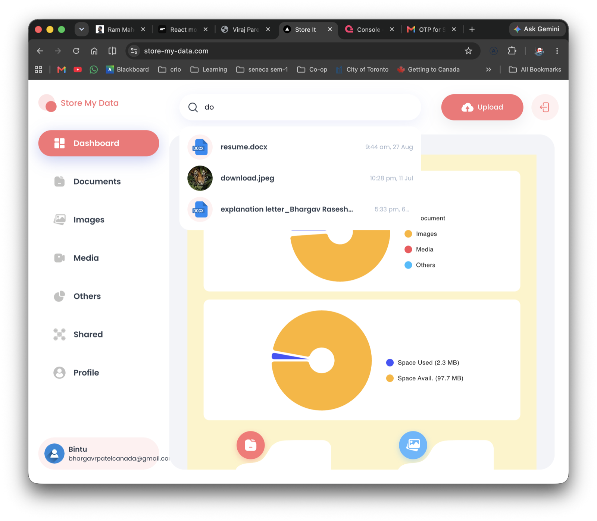
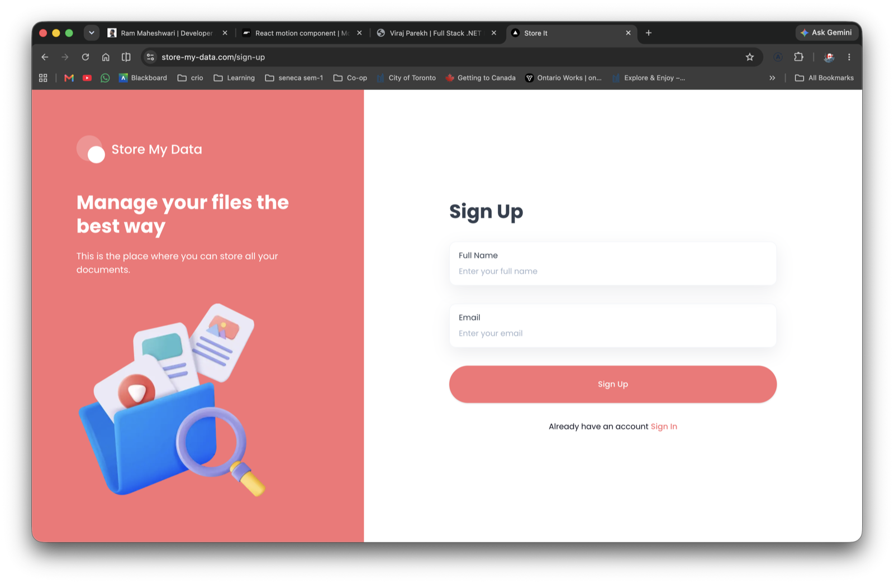
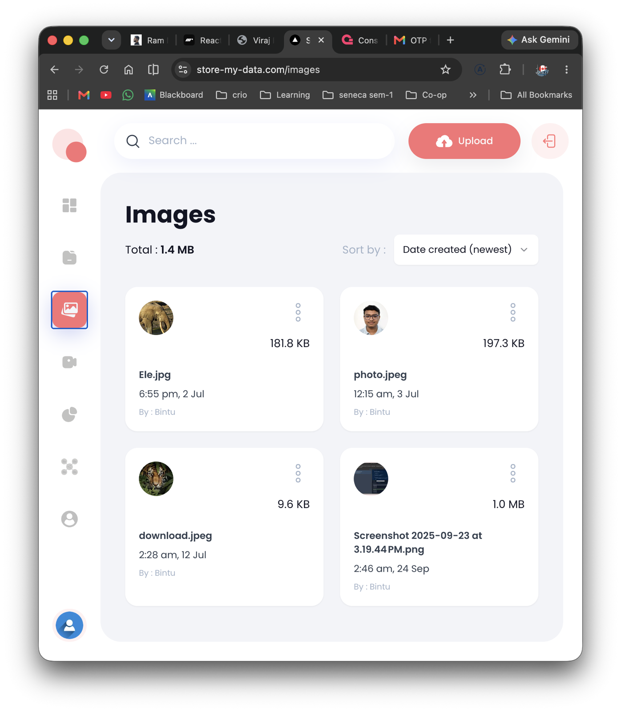
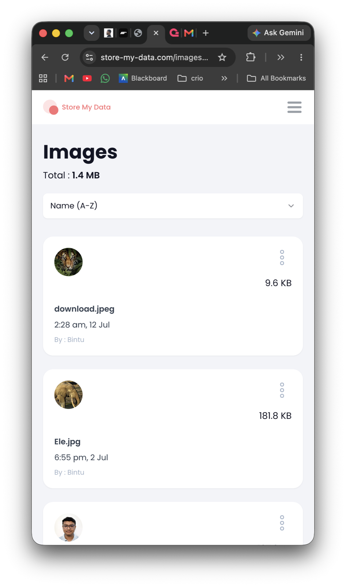
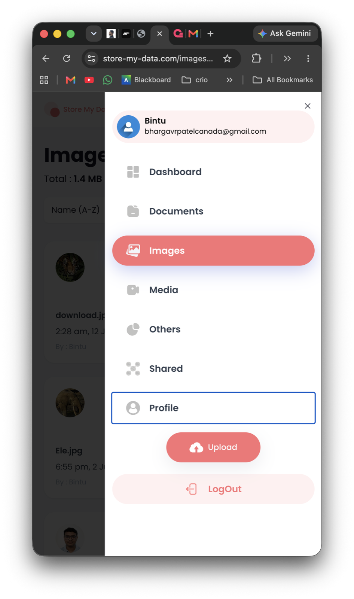

# ✨ Store My Data – File Storage Dashboard ✨


A personal cloud-storage web app: sign in with an email one-time code, upload files, and browse, search, sort, rename, share, download and delete them, with a dashboard showing how your 100 MB of storage is being used.

🌐 **Live Application:** https://store-my-data.com/

---

## 📸 Screenshots

### Dashboard

Two pie charts (storage by file type, used vs. available space) and a card per category with item count and total size.



### File browser and actions

Each category page lists its files as cards. The three-dot menu on a card offers Rename, Details, Share, Download and Delete.



### File details



### Global search

Search is debounced and shows matching files from every category as you type.



### Passwordless sign-up



### Responsive layout

| Tablet | Mobile | Mobile menu |
| :---: | :---: | :---: |
|  |  |  |

---

## 🚀 Features

- 🔐 **Passwordless auth** – sign up / sign in with a 6-digit OTP sent by email (Appwrite email tokens); the session is kept in an HTTP-only cookie
- 📂 **Upload** – drag-and-drop or file picker, with upload progress toasts
- 🗂️ **Automatic categories** – files are sorted by extension into Documents, Images, Media (video + audio) and Others
- ✏️ **File actions** – rename, view details, share by email, download, delete
- 🤝 **Shared page** – lists the files you have shared with other people
- 🔍 **Search** – debounced search across all your files
- ↕️ **Sort** – by date created, name or size, ascending or descending
- 📊 **Dashboard** – storage breakdown by category and used vs. available space
- 👤 **Profile** – name, email, avatar and a storage usage bar
- 📱 **Responsive** – full sidebar on desktop, icon rail on tablet, slide-out menu on mobile

### Storage limits

| Limit | Value |
| --- | --- |
| Maximum size per file | 15 MB |
| Total storage per user | 100 MB |

Both are constants in [`constant/index.ts`](./constant/index.ts).

---

## 🧱 Tech Stack

- **Framework:** Next.js 15 (App Router, Server Actions, Turbopack) with React 19 and TypeScript
- **Styling:** Tailwind CSS
- **UI Components:** shadcn/ui (Radix UI), lucide-react
- **Charts:** MUI X Charts
- **Forms & validation:** react-hook-form + zod
- **Uploads:** react-dropzone
- **Backend:** Appwrite (Auth, Databases, Storage) through `node-appwrite`
- **Deployment:** Vercel

---

## 📁 Project Structure

```
app/
  (auth)/            sign-in and sign-up pages
  (root)/
    dashboard/       storage overview with charts
    [type]/          documents, images, media, others, shared
    profile/         user info and storage usage
components/          Sidebar, Header, Search, Sort, Card, FileUploader,
                     ActionDropdown, OTPModal, ... and shadcn/ui primitives
lib/
  action/            server actions: file.action.ts, user.actions.ts
  appwrite/          Appwrite session/admin clients and config
  utils.ts           file type detection, size and date formatting
constant/            nav items, sort options, storage limits
types/               shared TypeScript types
```

---

## 🛠️ Getting Started

### Prerequisites

- Node.js 18.18 or later
- An [Appwrite](https://appwrite.io/) project with:
  - a database containing a **users** collection (`fullName`, `email`, `avatar`, `accountId`) and a **files** collection (`name`, `url`, `type`, `extension`, `size`, `owner`, `accountId`, `users`, `bucketFileId`)
  - a storage bucket
  - an API key with access to auth, databases and storage

### Install and run

```bash
git clone https://github.com/BhargavRaseshPatel/storage-drive-2.git
cd storage-drive-2
npm install
```

Create a `.env.local` file in the project root:

```env
NEXT_PUBLIC_APPWRITE_ENDPOINT=https://cloud.appwrite.io/v1
NEXT_PUBLIC_APPWRITE_PROJECT=
NEXT_PUBLIC_APPWRITE_DATABASE=
NEXT_PUBLIC_APPWRITE_USERS_COLLECTION=
NEXT_PUBLIC_APPWRITE_FILES_COLLECTION=
NEXT_PUBLIC_APPWRITE_BUCKET=
NEXT_APPWRITE_KEY=
```

Then start the dev server:

```bash
npm run dev
```

Open http://localhost:3000/sign-up to create an account.

### Scripts

| Command | Description |
| --- | --- |
| `npm run dev` | Start the dev server with Turbopack |
| `npm run build` | Create a production build |
| `npm run start` | Run the production build |
| `npm run lint` | Run ESLint |

---

## 🎯 Purpose

This project is designed to provide a simple and efficient way to store and manage personal files in one place with a user-friendly interface and clear storage insights.
